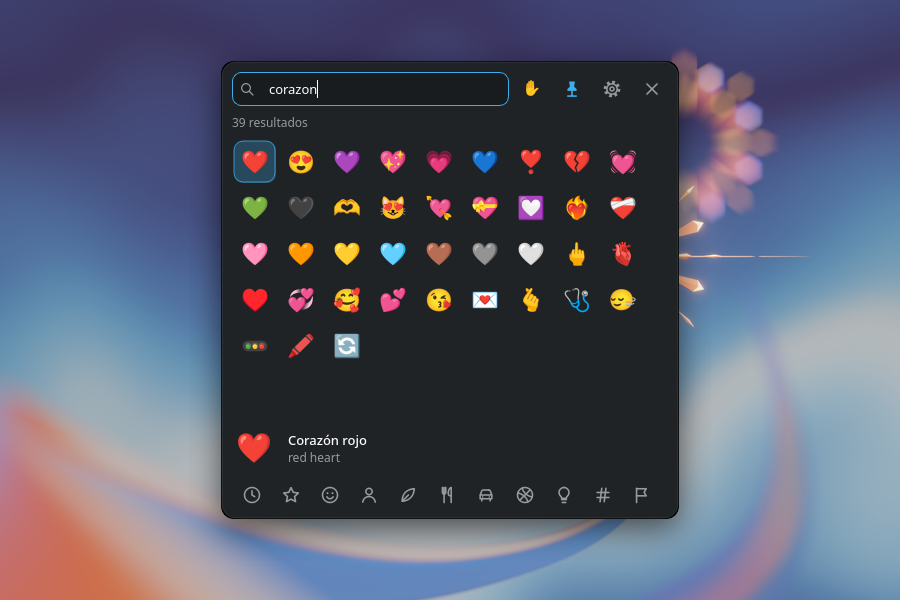

<p align="center">
  
</p>

<h1 align="center">Emojify</h1>

<p align="center">
  An emoji picker for KDE Plasma and Windows that types the emoji right where you were writing.
</p>

<p align="center">
  <a href="https://github.com/Amariless/Emojify-releases/releases/download/v1.0.0/Emojify-1.0.0-windows-setup.exe"></a>
  <a href="https://github.com/Amariless/Emojify-releases/releases/download/v1.0.0/emojify-1.0.0-linux.tar.gz"></a>
</p>

<p align="center">
  
</p>

## How it works

1. Press <kbd>Meta</kbd>+<kbd>.</kbd> (<kbd>Win</kbd>+<kbd>.</kbd> on Windows)
2. Type what you're looking for.
3. Press <kbd>Enter</kbd>.

The emoji appears in the window you were using: WhatsApp Web, Discord, Telegram, your browser or the terminal. No copying and pasting by hand.

<table>
  <tr>
    <td width="33%" valign="top">
      <h3>Search your way</h3>
      <p>Understands English and Spanish at the same time, ignores accents and capitals, and forgives typos.</p>
    </td>
    <td width="33%" valign="top">
      <h3>Keyboard first</h3>
      <p>It opens instantly with your recent emojis. Arrows to move, <kbd>Enter</kbd> to insert, <kbd>Esc</kbd> to close.</p>
    </td>
    <td width="33%" valign="top">
      <h3>Out of your way</h3>
      <p>Your chat never loses the focus, so pressing <kbd>Enter</kbd> fast never sends the message by accident. Works offline.</p>
    </td>
  </tr>
</table>

**Also:** skin tones, flags, favorites, inserting several emojis in a row without closing, and an interface in English, Spanish, Portuguese, French, German and Italian.

## Install

### Windows 10 / 11

1. [Download the installer](https://github.com/Amariless/Emojify-releases/releases/download/v1.0.0/Emojify-1.0.0-windows-setup.exe) and run it. It installs just for you, no administrator rights needed.
2. Press <kbd>Win</kbd>+<kbd>.</kbd> and try it. Emojify takes over that shortcut from the Windows emoji panel; you can pick another one in its settings.

Emojify starts with Windows and lives in the system tray. Prefer not to install? There's also a portable `.zip` on the [releases page](https://github.com/Amariless/Emojify-releases/releases/latest). To uninstall, go to *Settings → Apps*.

### KDE Plasma 6

It's tested on CachyOS and should work on any distribution with Plasma 6, like Fedora KDE, openSUSE, Kubuntu or KDE neon.

1. [Download the .tar.gz](https://github.com/Amariless/Emojify-releases/releases/download/v1.0.0/emojify-1.0.0-linux.tar.gz).
2. Open a terminal where you downloaded it and run:

```bash
tar xzf emojify-*-linux.tar.gz
cd emojify-*-linux
./install.sh
```

3. Press <kbd>Meta</kbd>+<kbd>.</kbd> and try it.

The installer takes care of everything and only asks for your password if it needs to install something on your system. To uninstall, run `./uninstall.sh` from the same folder.

Emojify tells you when there's a new version.

## Feedback

Found a bug, have an idea or just want to say something? Each button opens a short form.

<p>
  <a href="https://github.com/Amariless/Emojify-releases/issues/new?template=bug.yml"></a>
  <a href="https://github.com/Amariless/Emojify-releases/issues/new?template=idea.yml"></a>
  <a href="https://github.com/Amariless/Emojify-releases/issues/new?template=comment.yml"></a>
</p>

<details>
<summary><b>Keyboard shortcuts</b></summary>
<br>

| Key | Action |
|---|---|
| <kbd>Meta</kbd>+<kbd>.</kbd> / <kbd>Win</kbd>+<kbd>.</kbd> | Open or close (you can change it) |
| Typing | Search, no need to click first |
| Arrows | Move between emojis |
| <kbd>Enter</kbd> | Insert |
| <kbd>Shift</kbd>+<kbd>Enter</kbd> | Insert without closing (or the other way around, in settings) |
| <kbd>Space</kbd> with an empty search | Choose the skin tone of that emoji |
| <kbd>Ctrl</kbd>+<kbd>D</kbd> | Add to or remove from favorites |
| <kbd>Tab</kbd> | Switch between recents, favorites and categories |
| <kbd>Ctrl</kbd>+<kbd>,</kbd> | Settings |
| <kbd>Esc</kbd> | Clear the search or close |

</details>

<details>
<summary><b>If something doesn't work</b></summary>
<br>

**First,** open *Settings → Insertion → Diagnostics*: it shows what works and how to fix what doesn't.

**Windows: <kbd>Win</kbd>+<kbd>.</kbd> still opens the Windows emoji panel.** Emojify isn't running (start it from the Start menu), or the window you're in runs as administrator: Windows doesn't let regular apps read the keyboard of those windows.

**Plasma: your chat loses the focus when Emojify opens.** Emojify can't read the keyboard. Run `sudo usermod -aG input $USER`, then log out and back in.

**The shortcut does nothing.** Run `emojify --setup` and check in *System Settings → Shortcuts → KWin* that "Emojify" has <kbd>Meta</kbd>+<kbd>.</kbd> and nothing else uses it.

**It opens, but the emoji isn't pasted and you get a notification.** The service that sends the paste isn't running. Check `systemctl --user status ydotool.service` or run `./install.sh` again. Meanwhile, the emoji is copied and you can paste it with <kbd>Ctrl</kbd>+<kbd>V</kbd>.

**In one specific app it pastes late, or pastes what you had copied before.** Raise `paste_delay_ms` in the settings (to 80, for example). If it's a terminal Emojify doesn't recognize, add its window class to `terminals`.

**Deleting a flag in the Chrome or Brave address bar leaves a stray letter.** That's not Emojify: a flag is made of two special letters and Chromium's address bar deletes them one at a time. In regular text boxes it deletes the whole flag.

**Why not GNOME or Hyprland?** On Linux, Emojify relies on KWin, Plasma's window manager. It doesn't work on Plasma 5, GNOME or Hyprland.

**Logs:** `journalctl --user -u emojify -f` on Plasma. Unexpected errors are also saved to `emojify.log`, in `~/.local/share/emojify` or `%LOCALAPPDATA%\Emojify`.

</details>

<details>
<summary><b>How it inserts the emoji</b></summary>
<br>

While Emojify is open it works like an on-screen keyboard: your window keeps the focus, and what you type goes to Emojify's search instead of your chat.

**On Windows** it types the emoji into your window directly, as text. Your clipboard isn't touched.

**On Plasma Wayland** no app is allowed to type text into another window, so Emojify uses the clipboard without you noticing. It saves what you had copied, copies the emoji (without adding it to Klipper's history), sends <kbd>Ctrl</kbd>+<kbd>V</kbd> (or <kbd>Ctrl</kbd>+<kbd>Shift</kbd>+<kbd>V</kbd> in terminals) and restores what you had. It takes about 5 milliseconds. If something fails, the emoji stays copied and you get a notification: it never fails silently.

To do this it installs a small KWin script and a window rule, which you can see in System Settings. `emojify --unsetup` removes them and gives <kbd>Meta</kbd>+<kbd>.</kbd> back to Plasma's own picker. You can update the emoji list with `emojify --update`. Requires Python 3.11 or newer.

</details>

## Credits

Icon by [Sofyan Rofiq](https://www.flaticon.es/autores/sofyan-rofiq) on Flaticon. Emoji data from [Emojibase](https://emojibase.dev) and [Unicode CLDR](https://cldr.unicode.org). Emojis from Google's Noto Color Emoji on Linux, and [Twemoji](https://github.com/mozilla/twemoji-colr) by Twitter/X (CC-BY 4.0) on Windows.

Free for personal use. The full terms are in [LICENSE](LICENSE).
